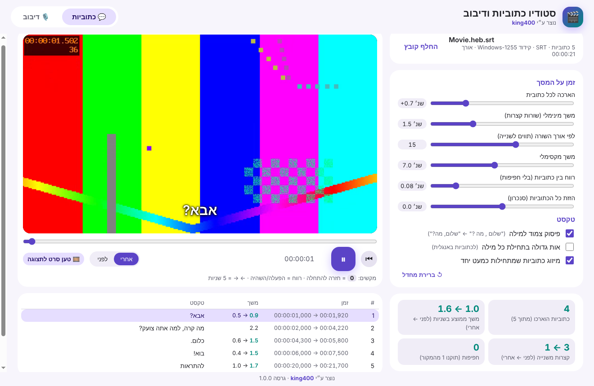
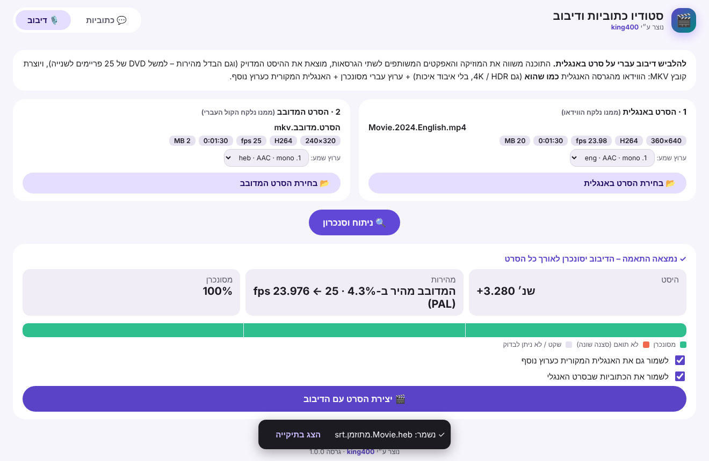

# 🎬 סטודיו כתוביות ודיבוב

**נוצר ע״י king400** · תוכנה ל-Windows, בממשק בעברית.

## 💬 כתוביות: יותר זמן על המסך, בלי חפיפות
- **טעינה:** קובץ אחד, **כמה קבצים יחד**, או **תיקייה שלמה (עונה)**. SRT או VTT, כולל עברית בקידוד ישן (Windows-1255). אפשר גם לגרור קבצים לחלון.
- **כמה קבצים:** אותן הגדרות חלות על כולם. עוברים בין הקבצים עם החיצים, ו**שומרים את כולם בלחיצה אחת** לתיקייה שבוחרים.
- **זמן על המסך:**
  - הארכה לכל כתובית.
  - **משך מינימלי**, כדי ששורות קצרות לא "יחלפו".
  - משך לפי אורך השורה (תווים לשנייה).
  - משך מקסימלי.
- **בלי חפיפות:** כל כתובית נגמרת לפני שהבאה מתחילה, עם רווח שאפשר לקבוע. חפיפות שהיו בקובץ המקורי מתוקנות.
- **הזזת כל הכתוביות:** לסנכרון, אם הן מקדימות או מאחרות.
- **פיסוק צמוד למילה:** "שלום , מה ?" הופך ל-"שלום, מה?".
- **אות גדולה בתחילת כל מילה:** לכתוביות באנגלית.
- **תצוגה מקדימה:** על רקע שחור או על הסרט עצמו, עם השוואה "לפני / אחרי".
- **מקשים:** **0** = חזרה להתחלה · רווח = הפעלה/השהיה · חצים = 5 שניות.
- **שמירה:** במקום שבוחרים, ב-UTF-8, כך שנגנים מציגים עברית נכון.

## 🎙️ דיבוב: להלביש דיבוב עברי על סרט באנגלית
1. בוחרים את **הסרט באנגלית**, וממנו נלקח הווידאו.
2. בוחרים את **הסרט המדובב**, וממנו נלקח הקול העברי. אפשר גם קובץ שמע בלבד.
3. **ניתוח וסנכרון:** התוכנה משווה את המוזיקה והאפקטים שמשותפים לשתי הגרסאות, ומוצאת:
   - את **ההיסט המדויק**, ברמת אלפיות שנייה.
   - **הבדל מהירות**, למשל DVD אירופאי ב-25 פריימים לשנייה מול 23.976. במקרה כזה המדובב מהיר ב-4.3%.
   - **סצנות שונות** בין הגרסאות. כל חלק מסונכרן בנפרד, ופס הזמן מראה מה תואם.
4. **יצירת הסרט:** נוצר קובץ MKV עם:
   - **הווידאו מהגרסה האנגלית כמו שהוא**, כולל **4K ו-HDR**, בלי קידוד מחדש ובלי איבוד איכות.
   - **ערוץ עברי מסונכרן** (ברירת מחדל).
   - **האנגלית המקורית** כערוץ נוסף.
   - הכתוביות שהיו בסרט האנגלי.

> הסנכרון עובד כשבשתי הגרסאות יש אותה מוזיקה ואותם אפקטים, כמו ברוב הדיבובים הרשמיים. כשההתאמה לא בטוחה, התוכנה אומרת זאת.

## התקנה
1. הורד את `MovieStudio-Windows.zip` מדף ה-Releases.
2. חלץ את הקובץ.
3. הפעל את `MovieStudio.exe`.

## בדיקות
| מה | איך |
|---|---|
| כתוביות: קריאה (כולל 1255), תזמון, בלי חפיפות, פיסוק, אותיות גדולות | `npm test` |
| סנכרון דיבוב על סרטים לבדיקה: מהירות PAL + היסט, סצנה חסרה, דיבוב שמתחיל מוקדם יותר. הקובץ שנוצר נבדק שהוא באמת מסונכרן (פחות מ-0.03 שנ׳) | `npm test`, רץ גם ב-Windows ב-GitHub Actions |
| התוכנה המלאה: שני הטאבים, תצוגה מקדימה, מקש 0, שמירה ויצירת סרט | `npm run test:e2e` (Playwright) |

## רישיונות
ffmpeg: גרסת LGPL של BtbN, עם קובץ הרישיון בתיקיית `resources/bin`.
